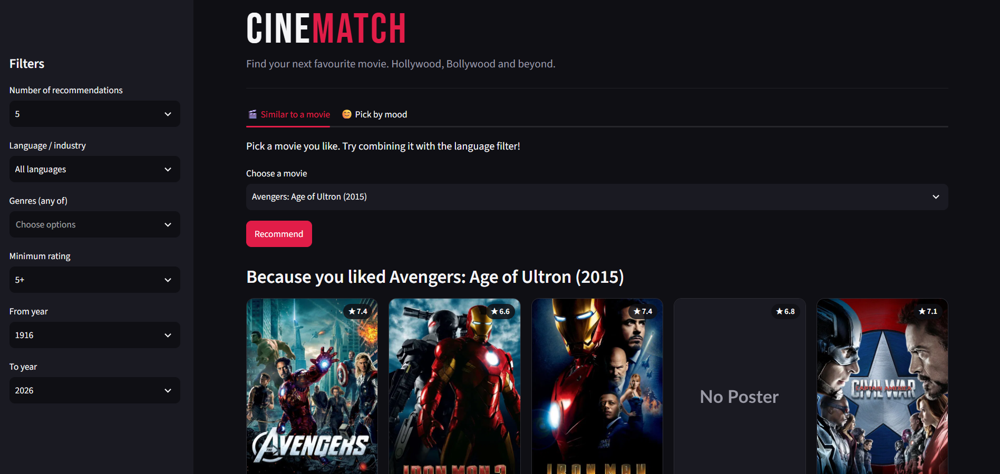
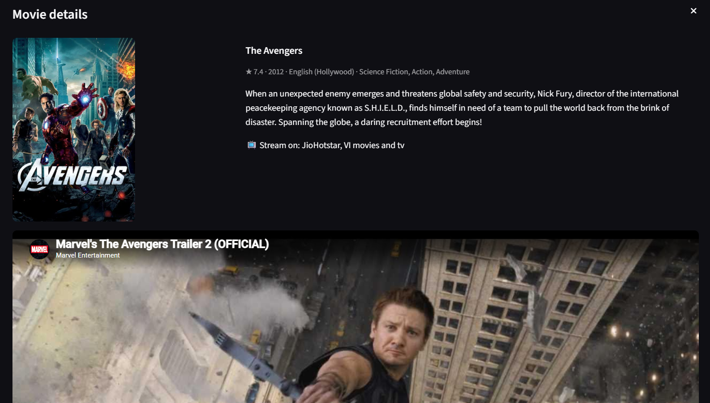
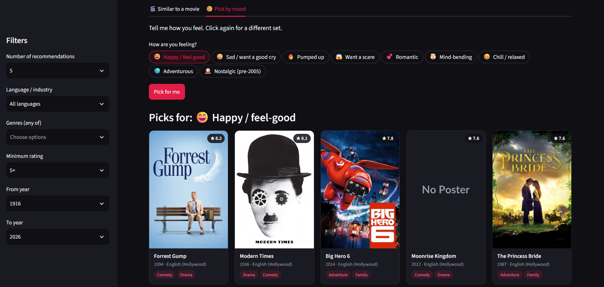

# CineMatch: Movie Recommender

A content-based movie recommender covering Hollywood, Bollywood and regional Indian cinema, built with Python, scikit-learn and Streamlit.

**Live demo:** _add link after deploying_



## Features
- Find similar movies with TF-IDF over plot, genres, keywords, cast and director (with stemming)
- Mood-based picks ("Happy", "Mind-bending", "Nostalgic", and more)
- Filters for language/industry, genre, rating and release year
- Poster grid UI with details pop-up, trailers and streaming availability (India) via the TMDB API
- About 6,000+ movies: TMDB 5000 plus Hindi, Tamil, Telugu, Malayalam, Kannada, Marathi, Bengali and Punjabi films




## How it works
Each movie's overview, genres, keywords, top 3 cast and director are combined into one text string, stemmed, and converted to TF-IDF vectors. Cosine similarity between vectors finds the closest movies. Mood picks filter by genre and rank with a weighted rating so low-vote movies don't dominate.

## Run locally
1. Install dependencies: `pip install -r requirements.txt`
2. Get a free API key from themoviedb.org and create `.streamlit/secrets.toml`:
   ```
   TMDB_API_KEY = "your_key"
   ```
3. Start the app: `streamlit run app.py`

## Rebuilding the data (optional)
1. Download the TMDB 5000 Movie Dataset from Kaggle (`tmdb_5000_movies.csv`, `tmdb_5000_credits.csv`) into the project folder.
2. Run `python build_indian_dataset.py` to fetch Indian movies from the TMDB API.
3. Run the notebook `recommender.ipynb` to produce `movies_all.pkl`.

## Tech
Python, pandas, scikit-learn, NLTK (stemming), Streamlit, TMDB API

_Movie data and images from TMDB. Streaming availability by JustWatch. This product uses the TMDB API but is not endorsed or certified by TMDB._